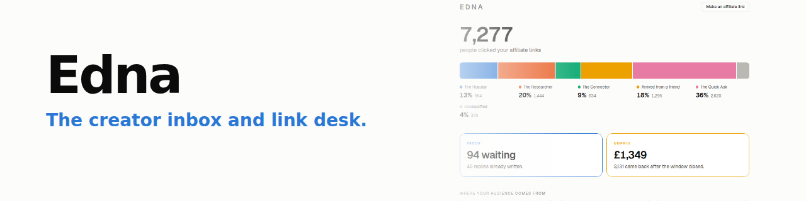
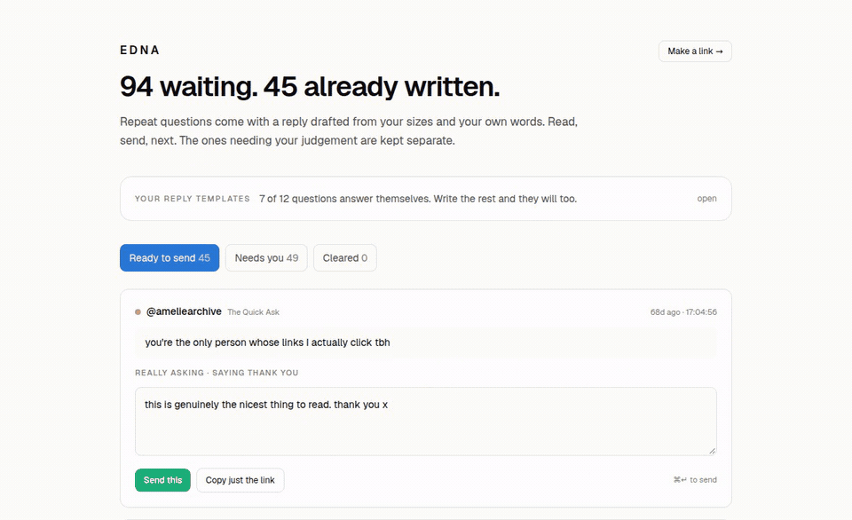
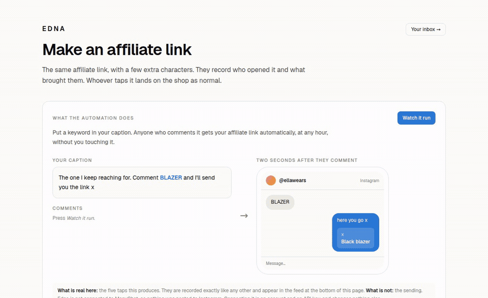
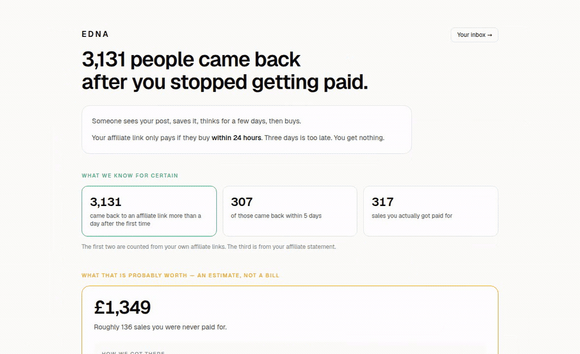
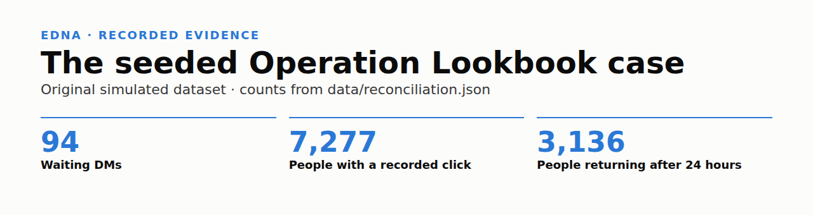
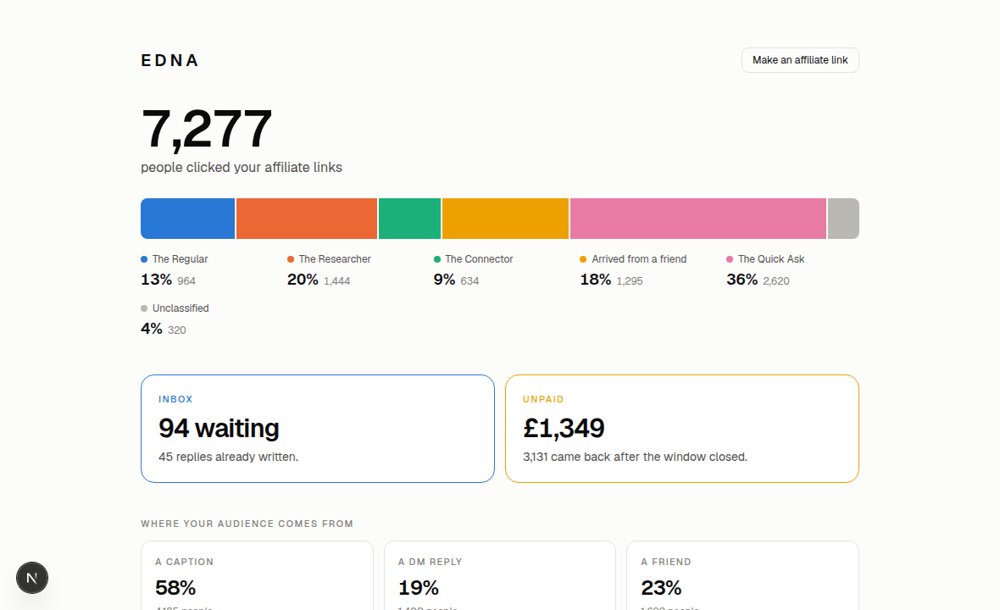
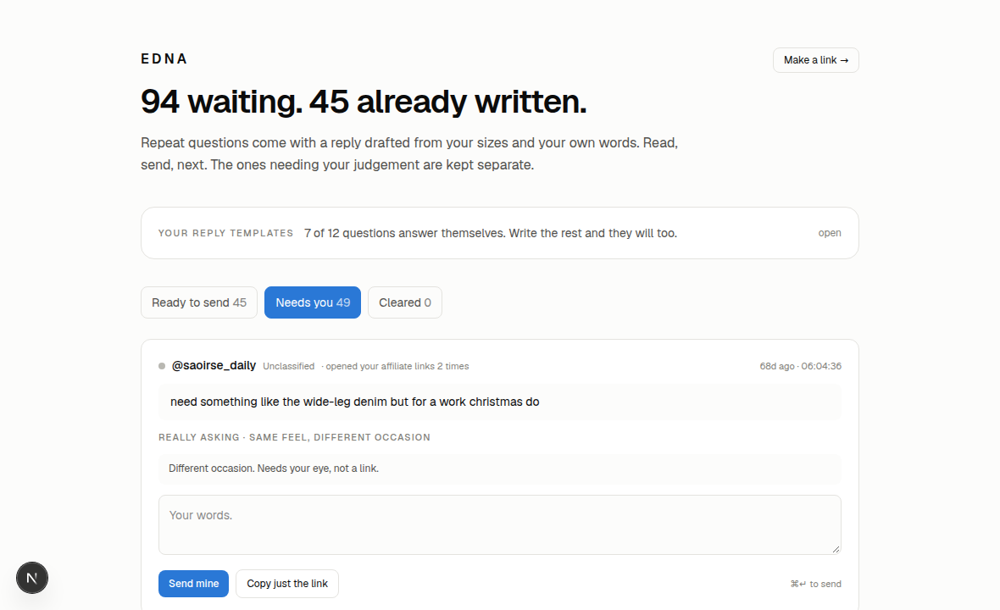
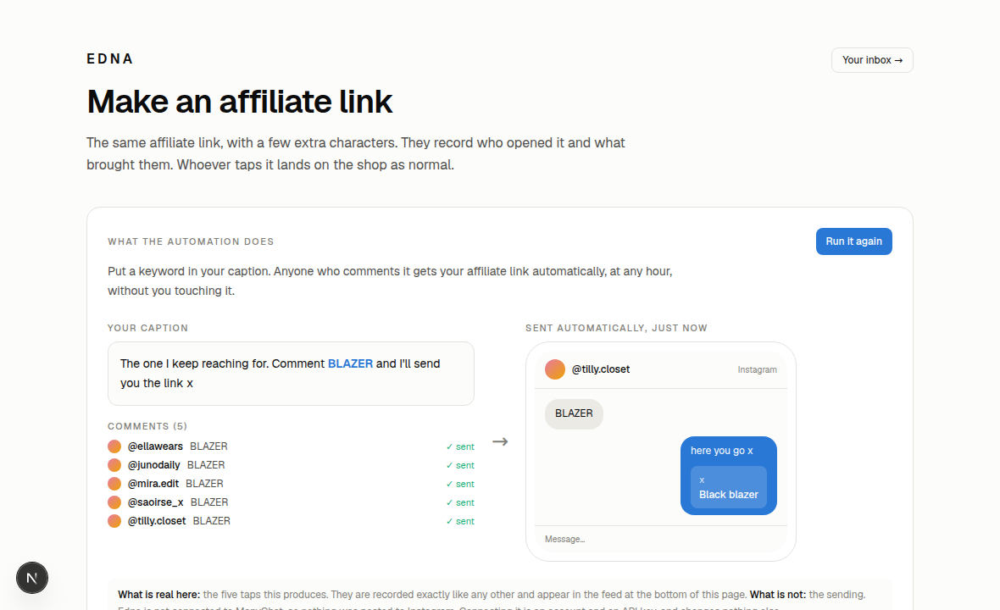

# Edna

[](package.json)
[](package.json)
[](#installation)

Creators who give personal shopping advice also have to answer repeated sizing questions, paste links and reconcile affiliate reports. In the Operation Lookbook brief, Sofia has roughly 3,100 DMs per month and one part-time assistant.

Edna brings that work into one inbox, with draft replies based on Sofia's notes and tagged links that show when readers come back. The seeded demo includes **94 waiting DMs** and illustrates how the inbox separates routine drafts from questions that need her judgement. [Seeded counts](data/reconciliation.json)

Built for TANO Creator Heist's Operation Lookbook challenge. The team reported the Most Innovative Solution award. The historical audience is synthetic, and the comment-to-DM walkthrough simulates sending. The local redirect records demo clicks in the app.

**[Run the interactive demo](#installation)** · **[Watch the seeded workflow](docs/assets/edna-demo.mp4)**


<sub>Recorded from the working app with its seeded data. The demo sends no external messages.</sub>

## How it works

1. **Triage the inbox.** Edna uses templates and wardrobe notes to prepare repeated replies. Questions that need the creator's judgement remain in a separate queue, and the creator can edit both templates and drafts (`app/inbox/Triage.tsx`, `lib/templates.ts`).

   

2. **Send readers through a tagged link.** The Links page plays a sample keyword-to-DM flow. The local redirect records a click with its source and item, so the feed shows the new events as the demo runs (`app/links/CommentDemo.tsx`, `app/r/[slug]/route.ts`).

   

3. **See who returns after the affiliate window.** The reporting screen compares first and last clicks with the affiliate window. It shows late returners separately from the commission estimate (`app/owed/page.tsx`, `lib/owed.ts`).

   

## Results



The figures describe the original seeded dataset. The seed assumptions and saved reconciliation explain which quantities came from the case file and which were modelled. Late returns count clicks after the 24-hour window. [Reconciliation](data/reconciliation.json) · [Seed assumptions](scripts/seed.mjs)

| Seeded demo quantity | Result |
| --- | ---: |
| Waiting DMs | **MEASURED in seeded data** · 94 |
| People with a recorded synthetic click | **MEASURED in seeded data** · 7,277 |
| People returning after the pay window | **MEASURED in seeded data** · 3,136 |

| Audience dashboard | Inbox triage | Tagged-link run |
| --- | --- | --- |
|  |  |  |

## Installation

You need Git and Node.js 22 or later. The bundled demo runs with local data.

```sh
git clone https://github.com/atiladeokegab/corgi_hack.git
cd corgi_hack
npm ci                 # Install the pinned dependencies
node scripts/seed.mjs  # Optional, regenerate the synthetic starting dataset
npm run dev            # Open http://localhost:3000
```

## Documentation

[Demo walkthrough](DEMO.md) · [Saved dataset summary](data/reconciliation.json) · [Seed assumptions](scripts/seed.mjs).

## Contact

Use [GitHub Issues](https://github.com/atiladeokegab/corgi_hack/issues) for bugs or questions. [Repository contributors](https://github.com/atiladeokegab/corgi_hack/graphs/contributors).

## Contributing

Run `npm run lint` and check the inbox and tagged-link workflows locally. Keep examples grounded in the synthetic case material.

## Citation

```bibtex
@software{edna_2026,
  title = {Edna: Operation Lookbook},
  author = {{Team Edna}},
  year = {2026},
  url = {https://github.com/atiladeokegab/corgi_hack}
}
```

## License

Contact the maintainers for terms on the project code. The [event case material](evidence/) comes from TANO Creator Heist. The click and inbox examples are synthetic outputs of the [repository seed script](scripts/seed.mjs).
